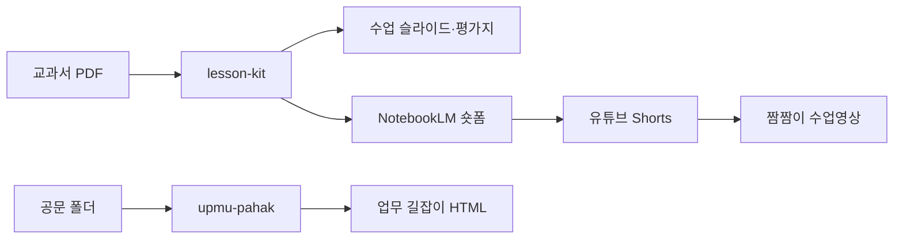

# 안녕하세요, 송화영입니다 

**초등교사 19년차 · 교사 대상 AI 자동화 연수 강사 · 도구 개발자**

선생님이 먼저 편안해야 교실이 편안해집니다. 
그래서 반복되는 업무는 AI 에이전트에게 맡기고, 그 시간을 학생에게 돌려주는 도구를 만듭니다.

---

##  하고 있는 일

| | 내용 |
|---|---|
|  **수업 도구** | 수업 자투리 1~5분에 전자칠판으로 바로 쓰는 **짬짬이** 시리즈. 설치도 로그인도 없고, 인터넷이 끊겨도 돌아갑니다. |
|  **업무 자동화** | 공문 폴더를 업무 지도로 바꾸는 **업무 길잡이**, 작년 한글 공문을 서식으로 쓰는 **HWPX 서식 채우기** |
|  **연수와 강의** | 교사 업무 자동화 따라 하기 안내, 강의 덱·대본·PPTX를 한 번에 만드는 **lecture-deck** |

---

##  짬짬이 가족 (바로 열어 보세요)

| 이름 | 하는 일 | 바로 하기 |
|---|---|---|
| 짬짬이 게임 | 미니게임 105종 | [열기](https://shway81-droid.github.io/jjam/) |
| 짬짬이 퀴즈 | 문답형 게임 모음 | [열기](https://shway81-droid.github.io/jjam-quiz/) |
| 짬짬이 영상 | 짧은 교육 영상 고르기 | [열기](https://shway81-droid.github.io/jjam-video/) |
| 짬짬이 이야기 | 생각하고 말하기 (3~7분) | [열기](https://shway81-droid.github.io/jjam-story/) |
| 짬짬이 낱말 | 반 전체가 입으로 외치는 말놀이 | [열기](https://shway81-droid.github.io/jjam-word/) |
| 짬짬이 수업영상 | 교과서 차시마다 수업에 바로 쓰는 영상 | [열기](https://shway81-droid.github.io/jjam-1min/) |
| 짬짬이 쉼 | 들뜬 반을 차분하게 만드는 자동 진행 활동 | [열기](https://shway81-droid.github.io/jjam-rest/) |
| 짬짬이 스트레칭 | 동작 100개, 딸깍 한 번 자동 진행 | [열기](https://shway81-droid.github.io/jjam-stretch/) |
| 짬짬이 그리기 | 화면이 한 획씩 보여 주면 종이에 따라 그리기 | [열기](https://shway81-droid.github.io/jjam-draw/) |

소스는 [`jjam-classroom`](https://github.com/shway81-droid/jjam-classroom) 에 모여 있습니다.

---

##  Claude · Aside 스킬 (가져다 쓰세요)

| 스킬 | 한 줄 소개 |
|---|---|
| [`lesson-kit`](https://github.com/shway81-droid/lesson-kit) | 교과서 한 차시를 넣으면 동기유발 영상, 수업 슬라이드, 형성평가, 개념정리가 나옵니다. |
| [`lecture-deck`](https://github.com/shway81-droid/lecture-deck) | 주제 하나로 강의 덱, 강사 대본, 오프라인 배포본, 편집 가능한 PPTX까지 만듭니다. |
| [`upmu-pahak`](https://github.com/shway81-droid/upmu-pahak) | 1년치 공문 폴더를 업무 담당자용 '업무 길잡이' HTML 한 장으로 바꿉니다. |
| [`hwpx-form-filler-plugin`](https://github.com/shway81-droid/hwpx-form-filler-plugin) | 작년 HWPX 공문을 서식으로 삼아 올해 초안을 자동 생성합니다. |
| [`jjam-1min-skill`](https://github.com/shway81-droid/jjam-1min-skill) | 교과서 차시를 1분 세로 영상으로 만들고 유튜브 Shorts와 사이트 등록까지 이어 갑니다. |

> 설치는 각 저장소 README의 한 줄 명령을 그대로 따라 하면 됩니다.

---

##  연수 자료

-  [교사 업무 자동화 1일차 · 따라 하기](https://shway81-droid.github.io/teacher-day1/)
-  [생활 자동화 1일차 · 학부모 따라 하기](https://shway81-droid.github.io/claude-day1/)
-  [생활 자동화 2일차 · 따라 하기](https://shway81-droid.github.io/claude-day2/)

---

##  한눈에 보는 흐름

---

##  함께해요

도구를 써 보시다가 불편한 점이나 바라는 점이 있으면 각 저장소의 **Issues**에 편하게 남겨 주세요. 
교실에서 실제로 쓰이는 도구가 되도록 계속 고치고 있습니다.

*교사의 시간은 학생에게* 

